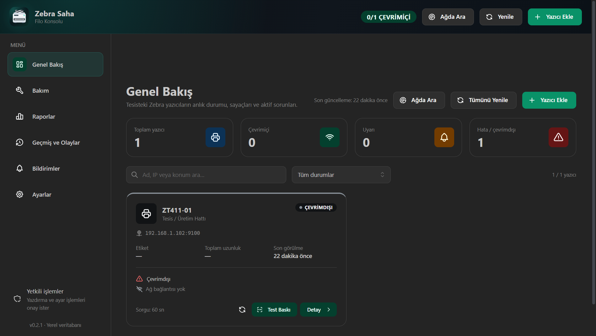
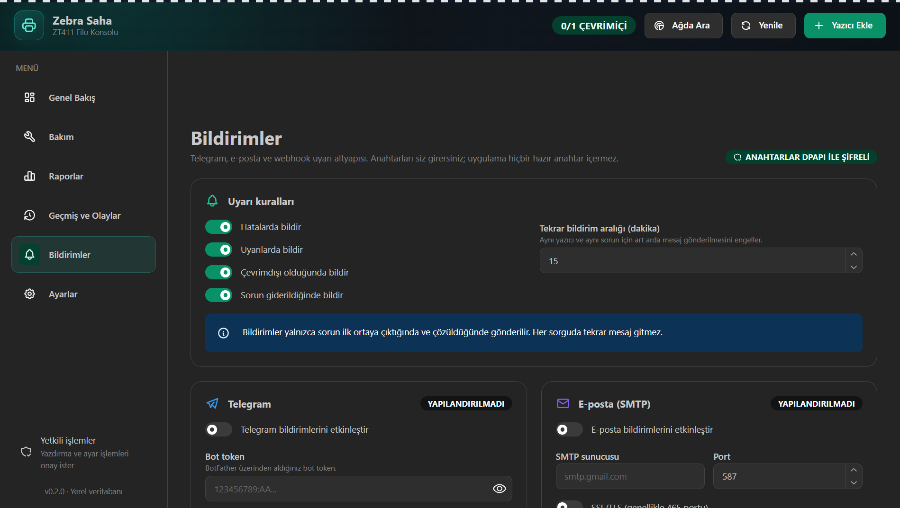
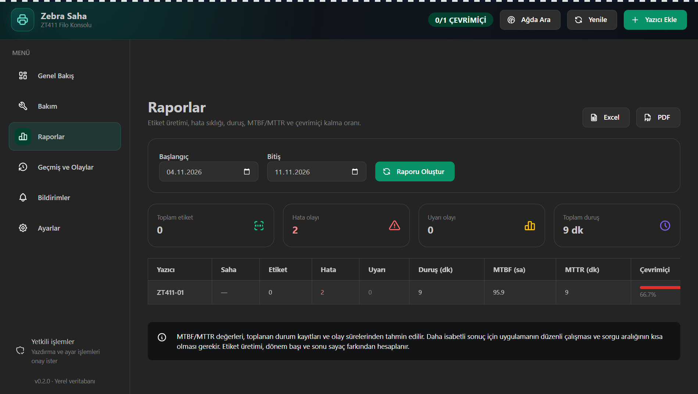
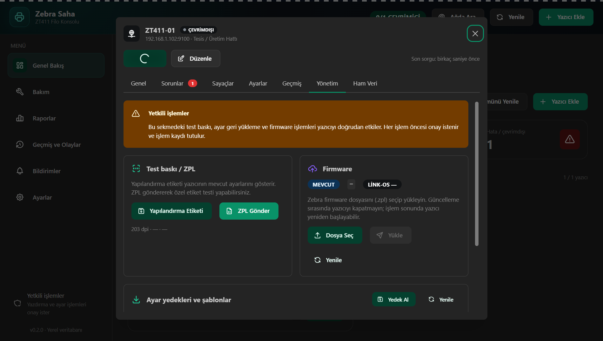
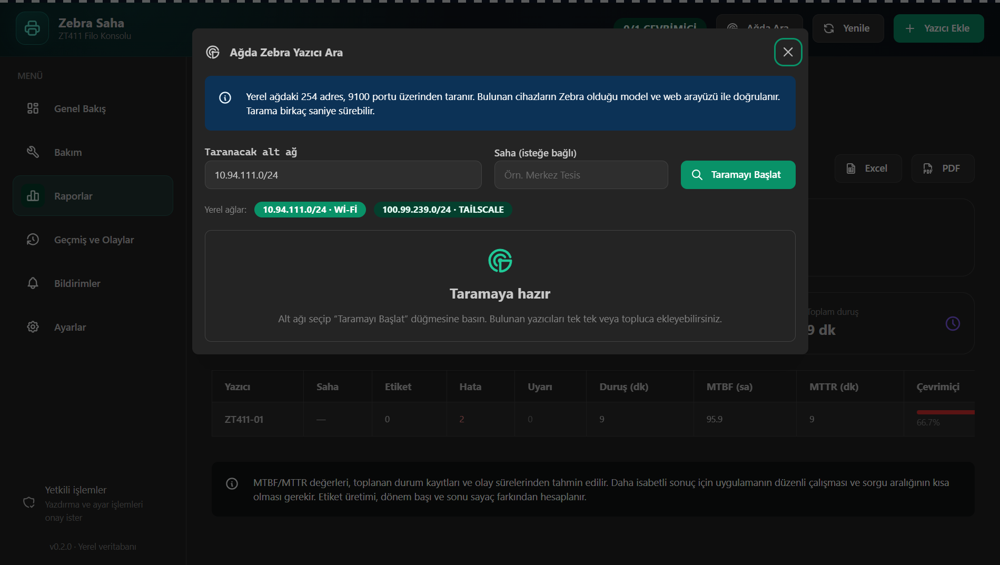
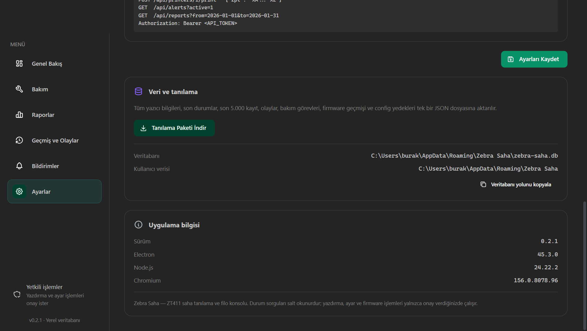
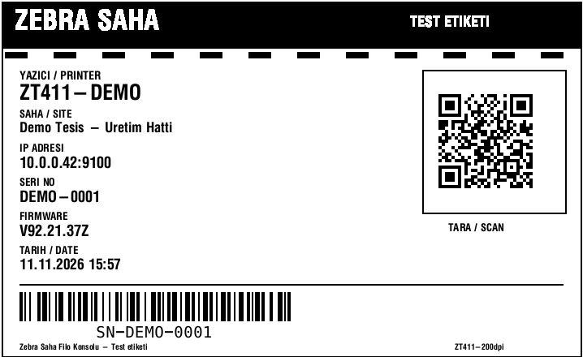
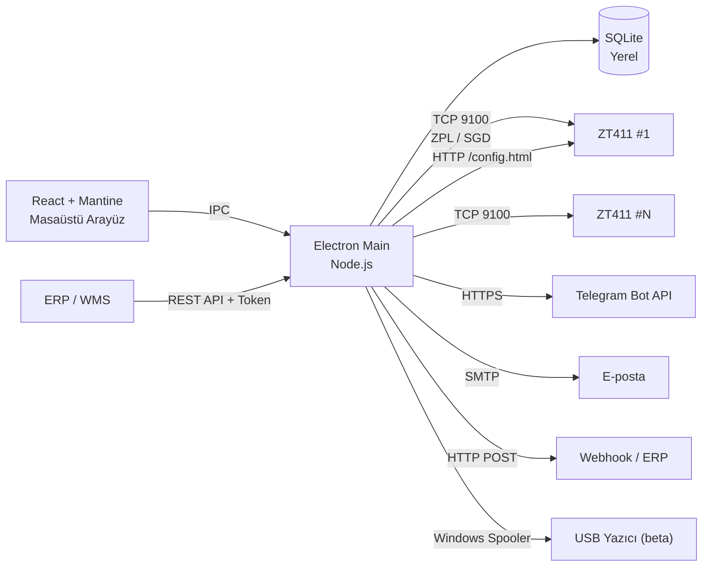

<div align="center">


# Zebra Filo Saha

**ZT411 filo izleme, tanılama ve saha yönetimi.**  
Yerel çalışır, Türkçe konuşur, tek tıkla test etiketi basar.

[](https://github.com/darksoftinc/ZebraFiloSaha)
[](https://github.com/darksoftinc/ZebraFiloSaha)
[](https://www.electronjs.org/)
[](https://react.dev/)
[](https://www.typescriptlang.org/)
[](https://www.zebra.com/)
[](#güvenlik-ve-gizlilik)

[Özellikler](#-özellikler) · [Ekran Görüntüleri](#-ekran-görüntüleri) · [Kurulum](#-kurulum) · [Yazıcı Ekleme](#-yazıcı-ekleme) · [Mimari](#-mimari) · [API](#-erp--rest-api)

</div>

> [!NOTE]
> **v0.2.1** · Windows 10/11 · Yerel SQLite · Bulut hesabı gerekmez · Türkçe arayüz  
> Kurulum paketi depoya konmaz (129 MB); `npm run dist` ile üretilir veya GitHub Releases'e eklenir.

---

## 🖨️ Neden Zebra Filo Saha?

Beş ZT411, üç farklı vardiya, bir sürü “yazıcı yine basmıyor” telefonu… Klasik yöntemde
her yazıcıya tek tek gidilir, web arayüzüne bakılır, hata kodu akılda tutulmaya çalışılır.
Zebra Filo Saha bunu tek ekrana taşır:

- Yazıcıya **tek tıkla** test etiketi gönderir.
- `~HS` / `~HQES` bayraklarını **Türkçe** hata ve çözüm önerisine çevirir.
- Etiket, hata, duruş ve **MTBF/MTTR** geçmişini yerelde tutar.
- Telegram, e-posta ve webhook ile **siz uyurken** haber verir.
- ERP/WMS için **token korumalı REST API** sunar.
- Tüm veri sizin bilgisayarınızda kalır; varsayılan olarak bulut yoktur.

---

## ✨ Özellikler

| Alan | Ne yapar? |
|---|---|
| 🖨️ **Canlı filo izleme** | READY / PAUSE / ERROR / OFFLINE, aktif hata ve uyarılar, gecikme, uptime, RAM |
| 🔍 **Otomatik Zebra keşfi** | Yerel alt ağı tarar; model, seri ve firmware doğrular; tek tek veya topluca ekler |
| 🏷️ **Janjanlı test etiketi** | Siyah başlık, zebra şerit, QR kod ve Code 128 barkod |
| 🧰 **Canlı ayar yönetimi** | Darkness, hız, baskı yöntemi, media tipi, genişlik, baskı modu, kafa kapatma, reprint, tear-off, Energy Star |
| 💾 **Ayar yedeği** | Yedek al, mevcut ayarlarla karşılaştır, geri yükle, tüm yazıcılara şablon uygula |
| ⬆️ **Firmware** | Mevcut sürüm takibi, yerel `.zpl` seçip yükleme, ilerleme ve geçmiş |
| 🔔 **Bildirimler** | Telegram bot, SMTP e-posta, JSON webhook; anahtarları siz girersiniz |
| 🛠️ **Bakım** | Kafa temizliği, platen, media, printhead görevleri; tarih veya etiket eşiği |
| 📊 **Raporlar** | Etiket üretimi, hata/uyarı, duruş, MTBF/MTTR, çevrimiçi yüzdesi |
| 📥 **Excel / PDF** | Tek tıkla `.xlsx` ve `.pdf` filo raporu |
| 🌐 **ERP entegrasyonu** | Yerel REST API + Bearer token + webhook olayları |
| 🏭 **Çoklu saha** | Yazıcı bazında saha/tesis alanı, dashboard ve rapor filtresi |
| 🔌 **USB / Windows kuyruğu** | Windows spooler'dan durum okuma ve RAW ZPL gönderme (beta) |
| 🔐 **Yerel ve şifreli** | SQLite, DPAPI ile şifrelenmiş token/şifre, varsayılan olarak yalnızca localhost API |

---

## 📸 Ekran Görüntüleri

<table>
  <tr>
    <td width="50%">
      
      <br />
      <sub><b>Genel Bakış</b> — çevrimiçi durum, sayaçlar ve aktif sorunlar</sub>
    </td>
    <td width="50%">
      
      <br />
      <sub><b>Bildirimler</b> — Telegram, SMTP ve webhook altyapısı</sub>
    </td>
  </tr>
  <tr>
    <td width="50%">
      
      <br />
      <sub><b>Raporlar</b> — etiket, hata, duruş, MTBF/MTTR ve Excel/PDF</sub>
    </td>
    <td width="50%">
      
      <br />
      <sub><b>Yönetim</b> — test baskı, config yedeği, geri yükleme ve firmware</sub>
    </td>
  </tr>
  <tr>
    <td width="50%">
      
      <br />
      <sub><b>Otomatik keşif</b> — alt ağ taraması ve Zebra doğrulama</sub>
    </td>
    <td width="50%">
      
      <br />
      <sub><b>Ayarlar</b> — izleme, tema, veri saklama, ERP API</sub>
    </td>
  </tr>
</table>

### 🏷️ Yeni test etiketi

<p align="center">
  
</p>

> Siyah başlık, zebra şerit motifi, QR kod, Code 128 barkod ve düzenli bilgi alanları.
> Her test baskısı bir etiket tüketir; tek tıkla gönderilir.

---

## 🚀 Kurulum

### Geliştirici olarak

Gereksinim: **Node.js 22+** ve Windows 10/11.

```powershell
git clone https://github.com/darksoftinc/ZebraFiloSaha.git
cd ZebraFiloSaha
npm install
npm run dev
```

### Kurulum paketi üretme

```powershell
npm run typecheck
npm run build
npm run dist
```

Çıktı: `release\Zebra Saha-0.2.1-x64.exe`

> [!TIP]
> Depo yalnızca kaynak kodu içerir. 129 MB'lık kurulum paketi GitHub'ın dosya
> sınırına yaklaştığı için Releases'e eklenmelidir.

### İlk açılış

1. Uygulamayı açın.
2. **Ağda Ara** veya **Yazıcı Ekle** ile ilk ZT411'i ekleyin.
3. **Bağlantıyı Test Et** ile model / firmware / durumu doğrulayın.
4. Kaydedin; ilk sorgu otomatik başlar.

---

## ➕ Yazıcı Ekleme

### Otomatik keşif

1. Üst çubukta **Ağda Ara**.
2. Doğru alt ağı seçin (Wi-Fi/Ethernet önceliklidir; Tailscale altta görünür).
3. **Taramayı Başlat**.
4. Bulunanları tek tek veya **Kalanları ekle** ile topluca ekleyin.

Keşif, 9100 portunu tarar; model/firmware için `~HI`, seri/durum için yazıcının web
başlığını doğrular. Farklı ağdaysanız alt ağı elle girin: `192.168.1.0/24`.

### Elle ekleme

| Alan | Değer |
|---|---|
| Ad | Örn. `Üretim Hattı 1` |
| Bağlantı | Ağ (Ethernet / Wi-Fi) |
| IP adresi | Örn. `192.168.1.102` |
| Port | **9100** (Zebra ham baskı) |
| Saha / konum | Örn. `Merkez Tesis / Paketleme` |
| Sorgu aralığı | 15–3600 saniye |

USB yazıcı için bağlantı türünü **Windows yazıcı kuyruğu** seçin; kuyruk adını listeden
seçin. Bu modda durum Windows spooler'dan okunur; SG D ayar yazma ve firmware desteklenmez.

---

## 🔔 Bildirim Altyapısı

**Bildirimler** sayfasında üç kanal vardır:

- **Telegram**: BotFather'dan bot token + chat ID.
- **E-posta (SMTP)**: sunucu, port, SSL/TLS, kullanıcı, şifre, gönderen, alıcılar.
- **Webhook**: HTTPS adresi; olaylar JSON olarak POST edilir.

Her kanalda **Test Gönder** vardır. Formda boş bırakılan token/şifre alanları mevcut
kaydı korur. Anahtarlar Windows **DPAPI** ile şifrelenir; arayüze geri dönmez, yalnızca
“kayıtlı” bilgisi gösterilir.

Kurallar: hata, uyarı, çevrimdışı ve sorun giderildi. Aynı yazıcı + aynı sorun için
tekrar aralığı (varsayılan 15 dk) ile mesaj yağmuru engellenir.

---

## 🧰 Yetkili İşlemler

Yazıcı detayı → **Yönetim**:

- **Yapılandırma etiketi** (`~WC`) veya özel **ZPL** gönderme.
- **Ayar yedeği** alma, mevcut ayarlarla karşılaştırma, geri yükleme.
- **Tümüne Uygula**: bir yedeği/şablonu tüm ağ yazıcılarına uygulama; önce her yazıcı
  için otomatik yedek alır.
- **Firmware**: yerel `.zpl` dosyası seçip yükleme; ilerleme ve geçmiş.

Yazıcı detayı → **Ayarlar**:

- Darkness, hız, baskı yöntemi, media tipi, baskı genişliği, baskı modu.
- Kafa kapatma davranışı, açılışta media, reprint, tear-off, Energy Star.
- Uygulama öncesi otomatik yedek + onay + denetim kaydı.
- IP/DHCP güvenlik için salt okunur.

Tüm işlemler **İşlem Geçmişi**'ne yazılır.

---

## 🛠️ Bakım ve Raporlar

- **Bakım**: görev ekleme, tarih/etiket eşiği, tamamlama, silme; gecikmiş ve yaklaşan
  görev özeti.
- **Raporlar**: tarih aralığı, saha filtresi, etiket üretimi, hata/uyarı, duruş,
  MTBF/MTTR, çevrimiçi yüzdesi; Excel ve PDF dışa aktarma.

> MTBF/MTTR değerleri toplanan örnekler ve olay sürelerinden **tahminidir**. Daha isabetli
> sonuç için uygulamanın düzenli açık kalması ve sorgu aralığının kısa olması gerekir.

---

## 🧱 Mimari



### Veri toplama

| Yöntem | Kullanım |
|---|---|
| `~HS` | Kağıt, pause, kafa açık, ribon, sıcaklık, etiket boyu |
| `~HQES` | 16 bit hata/uyarı bayrakları |
| `~HI` / `~HM` | Model, firmware, RAM |
| SGD | `odometer.total_label_count`, `media.speed`, `print.tone`, `ezpl.*`, `device.uptime` |
| HTTP `/config.html` | Kesin `NONRESET CNTR` sayaçları (erişilebilirse) |

Sorgular yazıcı başına sırayla, kısa timeout'larla yapılır. İlk bağlantı Energy Star /
uyku modundan dolayı gecikirse bir kez daha denenir.

---

## 🌐 ERP / REST API

**Ayarlar → ERP / API entegrasyonu**:

- Varsayılan `127.0.0.1:3210`, yalnızca yerel erişim.
- `0.0.0.0` seçilirse **API token zorunludur**.
- Token: `Authorization: Bearer <token>` veya `X-Api-Token`.
- API üzerinden yazdırma varsayılan olarak **kapalıdır**.

| Metot | Yol | Açıklama |
|---|---|---|
| `GET` | `/api/health` | Sağlık kontrolü |
| `GET` | `/api/printers` | Tüm yazıcılar + son durum |
| `GET` | `/api/printers/:id` | Tek yazıcı + durum |
| `POST` | `/api/printers/:id/refresh` | Anlık sorgu |
| `POST` | `/api/printers/:id/print` | `{"zpl":"^XA...^XZ"}` (izin gerekir) |
| `GET` | `/api/alerts?active=1` | Aktif/geçmiş olaylar |
| `GET` | `/api/reports?from=...&to=...` | Filo raporu |

Örnek:

```bash
curl -H "Authorization: Bearer $TOKEN" http://127.0.0.1:3210/api/printers
curl -H "Authorization: Bearer $TOKEN" \
  -H "Content-Type: application/json" \
  -d '{"zpl":"^XA^FO50,50^A0N,40,40^FDERP TEST^FS^XZ"}' \
  http://127.0.0.1:3210/api/printers/1/print
```

Webhook gövdesi:

```json
{
  "event": "printer.issue",
  "timestamp": "2026-11-11T11:30:00.000Z",
  "printer": { "id": 1, "name": "ZT411-01", "host": "192.168.1.102", "site": "Merkez" },
  "state": "error",
  "issues": [{ "code": "MEDIA_OUT", "title": "Kağıt / etiket bitti" }]
}
```

---

## 🔐 Güvenlik ve Gizlilik

- Veritabanı: `%APPDATA%\Zebra Saha\zebra-saha.db`
- Log: `%APPDATA%\Zebra Saha\main.log` (5 MB'ta döner)
- Renderer izole (`contextIsolation`, `nodeIntegration` kapalı).
- Bildirim/API token ve şifreleri **DPAPI** ile şifrelenir.
- API varsayılan olarak yalnızca `127.0.0.1`; yerel ağa açarken token zorunlu.
- FTP kullanılmaz. Test edilen yazıcıda anonim FTP açıktı; üretimde kapatılmalıdır.
- Kurulum imzasızdır; Windows SmartScreen uyarabilir.
- Bu uygulama hiçbir veriyi kendi sunucusuna göndermez. Bildirim trafiği sizin
  seçtiğiniz Telegram/SMTP/webhook adreslerine gider.

---

## 🗂️ Proje Yapısı

```text
zebra-saha/
├─ src/
│  ├─ main/                 Electron ana süreç
│  │  ├─ db.ts              SQLite şeması ve sorgular
│  │  ├─ printer/           ZPL/SGD istemcisi, hata sözlüğü
│  │  ├─ discovery.ts       Alt ağ taraması
│  │  ├─ management.ts      Test baskı, ayar, firmware, Windows spooler
│  │  ├─ notifications.ts   Telegram / SMTP / webhook
│  │  ├─ api-server.ts      ERP REST API
│  │  ├─ reports.ts         MTBF/MTTR + Excel/PDF
│  │  └─ poller.ts          Zamanlayıcı ve durum geçmişi
│  ├─ preload/              Güvenli IPC köprüsü
│  ├─ renderer/             React + Mantine arayüz
│  └─ shared/               Tip ve API sözleşmeleri
├─ build/                   icon.svg / icon.ico / icon.png
├─ docs/                    Ekran görüntüleri
├─ scripts/                 build-icon.js
├─ package.json
└─ README.md
```

---

## 🧪 Geliştirme Komutları

```powershell
npm run typecheck      # TypeScript kontrolü
npm run build          # Üretim derlemesi
npm run dist           # Windows NSIS kurulum paketi
npm run dev            # Geliştirme modu (Vite + Electron)
```

> [!NOTE]
> Bu ortamda npm 12'nin optional-dependency hatası nedeniyle Electron binary'si
> otomatik indirilemedi. Gerekirse npm 11 kullanın veya Electron `win32-x64` zip'ini
> `node_modules/electron/dist` içine açıp `path.txt` dosyasına `electron.exe` yazın.

---

## 📝 Sürüm Notları

### v0.2.1
- Yazıcı detayındaki **Ayarlar** sekmesi düzenlenebilir; ayarlar tek düğmeyle uygulanır.
- Üstteki kesikli şerit kaldırıldı; üst sol köşedeki “ZT411” alt yazısı kaldırıldı.
- **Bildirimler** ve **Ayarlar** sayfalarında aşağı kaydırma düzeltildi.
- Özel yazıcı/zebra temalı uygulama ve masaüstü ikonu eklendi.
- Test etiketi yenilendi: siyah başlık, zebra şerit, QR kod ve Code 128 barkod.

### v0.2.0
- Telegram / e-posta / webhook bildirimleri.
- Otomatik Zebra keşfi.
- Test baskı ve ZPL gönderme.
- Config yedeği, diff, geri yükleme, şablon.
- Firmware yükleme ve geçmiş.
- Bakım görevleri, raporlar, Excel/PDF.
- ERP REST API + token, çoklu saha, USB/Windows kuyruğu.

### v0.1.0
- İlk canlı izleme, hata sözlüğü, sayaçlar, geçmiş ve tanılama paketi.

---

## ⚠️ Bilinen Sınırlar

- Kurulum paketi **imzasızdır**; SmartScreen uyarabilir.
- Firmware ve config geri yükleme canlı üretimde dikkatle test edilmelidir.
- USB/Windows kuyruğu desteği **beta**; fiziksel USB yazıcıda RAW baskı test edilmedi.
- Windows kuyruğunda SG D ayar yazma/firmware desteklenmez.
- Rapor MTBF/MTTR değerleri tahminidir.
- Zebra firmware dosyası otomatik indirilmez; yerel `.zpl` seçilir.

---

## 🤝 Katkı

1. Fork'layın.
2. Özellik dalı açın: `git checkout -b feature/yeni-ozellik`.
3. Değişiklikleri yapın; `npm run typecheck` ve `npm run build` çalıştırın.
4. Pull request açın.

Hata bildirimi ve öneriler için **GitHub Issues** kullanılabilir.

---

<div align="center">

**Zebra Filo Saha** — ZT411 filoları için yerel, Türkçe ve biraz janjanlı saha konsolu.

<sub>darksoftinc · 2026</sub>

</div>
