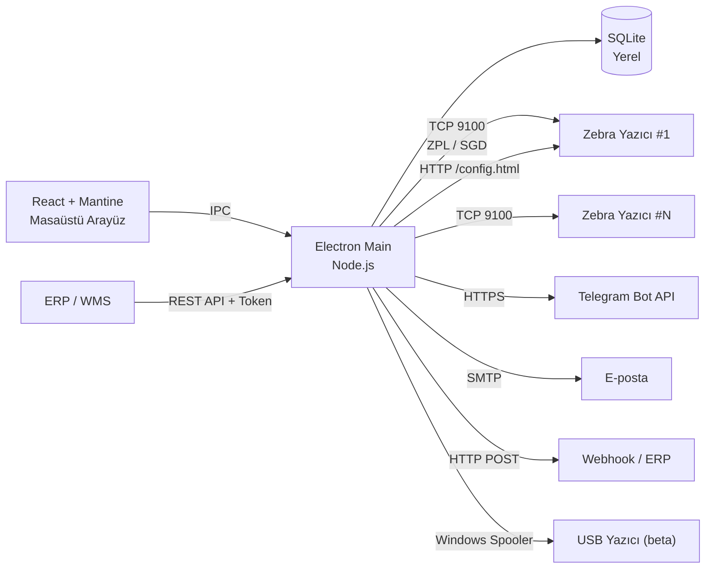

<div align="center">


# Zebra Filo Saha

**Zebra yazıcı filoları için yerel izleme, tanılama ve saha yönetimi.**  
Yerel altyapıda çalışır; Türkçe arayüz, merkezi durum takibi ve tek tıkla test baskısı sunar.

[](https://github.com/darksoftinc/ZebraFiloSaha)
[](https://github.com/darksoftinc/ZebraFiloSaha)
[](https://www.electronjs.org/)
[](https://react.dev/)
[](https://www.typescriptlang.org/)
[](https://www.zebra.com/)
[](#güvenlik-ve-gizlilik)

[Özellikler](#-özellikler) · [Ekran Görüntüleri](#-ekran-görüntüleri) · [Kurulum](#-kurulum) · [Yazıcı Ekleme](#-yazıcı-ekleme) · [Mimari](#-mimari) · [API](#-erp--rest-api)

</div>

> [!NOTE]
> **v0.2.1** · Windows 10/11 · Yerel SQLite · Bulut hesabı gerekmez · Türkçe arayüz  
> Kurulum paketi boyutu nedeniyle kaynak deposuna dahil edilmez. `npm run dist` ile
> üretilebilir veya GitHub Releases bölümüne eklenebilir.

---

## Genel Bakış

Çok sayıda yazıcının bulunduğu üretim ortamlarında arıza tespiti genellikle yazıcı başına
manuel kontrol gerektirir. Bu yaklaşım duruş süresini uzatır; hata kodlarının tutarsız
yorumlanmasına ve bakım geçmişinin kaybolmasına neden olur.

Zebra Filo Saha, bu operasyonları tek bir masaüstü uygulamasında birleştirir:

- Yazıcıya tek tıkla test etiketi gönderir.
- `~HS` ve `~HQES` bayraklarını Türkçe hata açıklamasına ve çözüm önerisine dönüştürür.
- Etiket üretimi, hata, duruş ve MTBF/MTTR verilerini yerel olarak saklar.
- Telegram, e-posta ve webhook kanallarıyla proaktif bildirim gönderir.
- ERP/WMS sistemleri için token korumalı REST API sunar.
- Tüm verileri yerel bilgisayarda saklar; varsayılan yapılandırmada bulut bağımlılığı yoktur.

---

## Özellikler

| Alan | Ne yapar? |
|---|---|
| **Canlı filo izleme** | READY / PAUSE / ERROR / OFFLINE, aktif hata ve uyarılar, gecikme, uptime ve RAM |
| **Otomatik yazıcı keşfi** | Yerel alt ağı tarar; model, seri ve firmware bilgisini doğrular; toplu ekleme yapar |
| **Profesyonel test etiketi** | Siyah başlık, zebra şerit motifi, QR kod ve Code 128 barkod |
| **Canlı ayar yönetimi** | Darkness, hız, baskı yöntemi, media tipi, genişlik, baskı modu, kafa kapatma, reprint, tear-off ve Energy Star |
| **Ayar yedeği** | Yedek alma, mevcut ayarlarla karşılaştırma, geri yükleme ve tüm yazıcılara şablon uygulama |
| **Firmware yönetimi** | Mevcut sürüm takibi, yerel `.zpl` dosyası yükleme, ilerleme göstergesi ve geçmiş |
| **Bildirimler** | Telegram bot, SMTP e-posta ve JSON webhook; anahtarlar kullanıcı tarafından girilir |
| **Bakım planı** | Kafa temizliği, platen, media ve printhead görevleri; tarih veya etiket eşiği |
| **Raporlama** | Etiket üretimi, hata/uyarı, duruş, MTBF/MTTR ve çevrimiçi kalma oranı |
| **Excel / PDF** | Tek tıkla `.xlsx` ve `.pdf` filo raporu |
| **ERP entegrasyonu** | Yerel REST API, Bearer token ve webhook olayları |
| **Çoklu saha** | Yazıcı bazında saha/tesis alanı; dashboard ve rapor filtreleri |
| **USB / Windows kuyruğu** | Windows spooler üzerinden durum okuma ve RAW ZPL gönderme (beta) |
| **Yerel ve şifreli** | SQLite veritabanı, DPAPI ile şifrelenmiş token/şifre, varsayılan olarak yalnızca localhost API |

---

## Ekran Görüntüleri

<table>
  <tr>
    <td width="50%">
      
      <br />
      <sub><b>Genel Bakış</b> — çevrimiçi durum, sayaçlar ve aktif sorunlar</sub>
    </td>
    <td width="50%">
      
      <br />
      <sub><b>Bildirimler</b> — Telegram, SMTP ve webhook altyapısı</sub>
    </td>
  </tr>
  <tr>
    <td width="50%">
      
      <br />
      <sub><b>Raporlar</b> — etiket, hata, duruş, MTBF/MTTR ve Excel/PDF</sub>
    </td>
    <td width="50%">
      
      <br />
      <sub><b>Yönetim</b> — test baskı, config yedeği, geri yükleme ve firmware</sub>
    </td>
  </tr>
  <tr>
    <td width="50%">
      
      <br />
      <sub><b>Otomatik keşif</b> — alt ağ taraması ve yazıcı doğrulama</sub>
    </td>
    <td width="50%">
      
      <br />
      <sub><b>Ayarlar</b> — izleme, tema, veri saklama ve ERP API</sub>
    </td>
  </tr>
</table>

### Test etiketi

<p align="center">
  
</p>

Test etiketi siyah başlık, zebra şerit motifi, QR kod, Code 128 barkod ve düzenli bilgi
alanlarından oluşur. Her test baskısı bir etiket tüketir ve tek tıkla gönderilir.

---

## Kurulum

### Geliştirme ortamı

Gereksinim: **Node.js 22+** ve Windows 10/11.

```powershell
git clone https://github.com/darksoftinc/ZebraFiloSaha.git
cd ZebraFiloSaha
npm install
npm run dev
```

### Kurulum paketi üretimi

```powershell
npm run typecheck
npm run build
npm run dist
```

Çıktı: `release\Zebra Saha-0.2.1-x64.exe`

> [!TIP]
> Depo yalnızca kaynak kodunu içerir. Kurulum paketi GitHub Releases bölümüne
> eklenebilir veya yerel olarak `npm run dist` ile üretilebilir.

### İlk açılış

1. Uygulamayı açın.
2. **Ağda Ara** veya **Yazıcı Ekle** ile ilk Zebra yazıcıyı ekleyin.
3. **Bağlantıyı Test Et** ile model, firmware ve durum bilgisini doğrulayın.
4. Kaydedin; ilk durum sorgusu otomatik olarak başlar.

---

## Yazıcı Ekleme

### Otomatik keşif

1. Üst çubukta **Ağda Ara** seçeneğini açın.
2. Doğru alt ağı seçin. Wi-Fi ve Ethernet arayüzleri önceliklendirilir; Tailscale gibi
   sanal arayüzler listede sona eklenir.
3. **Taramayı Başlat** düğmesine basın.
4. Bulunan yazıcıları tek tek veya **Kalanları ekle** ile topluca ekleyin.

Keşif işlemi 9100 portunu tarar; model ve firmware için `~HI`, seri ve durum bilgisi için
yazıcının web başlığını doğrular. Farklı bir ağdaysanız alt ağ adresini elle
girebilirsiniz: `192.168.1.0/24`.

### Elle ekleme

| Alan | Değer |
|---|---|
| Ad | Örn. `Üretim Hattı 1` |
| Bağlantı | Ağ (Ethernet / Wi-Fi) |
| IP adresi | Örn. `192.168.1.102` |
| Port | **9100** (Zebra ham baskı portu) |
| Saha / konum | Örn. `Merkez Tesis / Paketleme` |
| Sorgu aralığı | 15–3600 saniye |

USB bağlantılı yazıcılar için bağlantı türünü **Windows yazıcı kuyruğu** olarak seçin ve
kuyruk adını listeden belirleyin. Bu modda durum bilgisi Windows spooler üzerinden
okunur; SGD ayar yazma ve firmware güncelleme desteklenmez.

---

## Bildirim Altyapısı

**Bildirimler** sayfasında üç kanal bulunur:

- **Telegram**: BotFather üzerinden alınan bot token ve chat ID.
- **E-posta (SMTP)**: sunucu, port, SSL/TLS, kullanıcı, şifre, gönderen ve alıcı bilgileri.
- **Webhook**: HTTPS adresi; olaylar JSON formatında POST edilir.

Her kanalda **Test Gönder** düğmesi bulunur. Formda boş bırakılan token ve şifre alanları
mevcut kaydı korur. Anahtarlar Windows **DPAPI** ile şifrelenir; arayüze geri dönmez,
yalnızca “kayıtlı” bilgisi gösterilir.

Bildirim kuralları hata, uyarı, çevrimdışı ve sorun giderildi durumlarını kapsar. Aynı
yazıcı ve aynı sorun için tanımlanan tekrar aralığı (varsayılan 15 dakika) ile yinelenen
bildirimler engellenir.

---

## Yetkili İşlemler

Yazıcı detayı → **Yönetim**:

- **Yapılandırma etiketi** (`~WC`) veya özel **ZPL** gönderme.
- **Ayar yedeği** alma, mevcut ayarlarla karşılaştırma ve geri yükleme.
- **Tümüne Uygula**: bir yedeği veya şablonu tüm ağ yazıcılarına uygular; işlem öncesinde
  her yazıcı için otomatik yedek alır.
- **Firmware**: yerel `.zpl` dosyası seçilir ve yüklenir; ilerleme ile geçmiş görüntülenir.

Yazıcı detayı → **Ayarlar**:

- Darkness, hız, baskı yöntemi, media tipi, baskı genişliği ve baskı modu.
- Kafa kapatma davranışı, açılışta media, reprint, tear-off ve Energy Star.
- Uygulama öncesinde otomatik yedek alınır, kullanıcı onayı istenir ve işlem denetim
  kaydına eklenir.
- IP/DHCP ayarları, bağlantı kesilmesini önlemek için salt okunur tutulur.

Tüm işlemler **İşlem Geçmişi** ekranına kaydedilir.

---

## Bakım ve Raporlar

- **Bakım**: görev ekleme, tarih veya etiket eşiği tanımlama, tamamlama ve silme;
  gecikmiş ve yaklaşan görev özetleri.
- **Raporlar**: tarih aralığı ve saha filtresi; etiket üretimi, hata/uyarı, duruş,
  MTBF/MTTR ve çevrimiçi kalma oranı; Excel ve PDF dışa aktarma.

> MTBF/MTTR değerleri, toplanan durum örnekleri ve olay sürelerinden **tahmin** edilir.
> Daha isabetli sonuçlar için uygulamanın düzenli açık kalması ve sorgu aralığının kısa
> olması önerilir.

---

## Mimari



### Veri toplama

| Yöntem | Kullanım |
|---|---|
| `~HS` | Kağıt, pause, kafa açık, ribon, sıcaklık ve etiket boyu |
| `~HQES` | 16 bit hata ve uyarı bayrakları |
| `~HI` / `~HM` | Model, firmware ve RAM bilgisi |
| SGD | `odometer.total_label_count`, `media.speed`, `print.tone`, `ezpl.*`, `device.uptime` |
| HTTP `/config.html` | Erişilebilirse kesin `NONRESET CNTR` sayaçları |

Sorgular yazıcı başına sırayla ve kısa zaman aşımı değerleriyle gerçekleştirilir. İlk
bağlantı Energy Star veya uyku modu nedeniyle gecikirse bir kez daha denenir.

---

## ERP / REST API

**Ayarlar → ERP / API entegrasyonu**:

- Varsayılan `127.0.0.1:3210`; yalnızca yerel erişim.
- `0.0.0.0` seçildiğinde **API token zorunludur**.
- Token, `Authorization: Bearer <token>` veya `X-Api-Token` başlığıyla gönderilir.
- API üzerinden yazdırma varsayılan olarak **kapalıdır**.

| Metot | Yol | Açıklama |
|---|---|---|
| `GET` | `/api/health` | Sağlık kontrolü |
| `GET` | `/api/printers` | Tüm yazıcılar ve son durumları |
| `GET` | `/api/printers/:id` | Tek yazıcı ve durum bilgisi |
| `POST` | `/api/printers/:id/refresh` | Anlık durum sorgusu |
| `POST` | `/api/printers/:id/print` | `{"zpl":"^XA...^XZ"}` (izin gerekir) |
| `GET` | `/api/alerts?active=1` | Aktif ve geçmiş olaylar |
| `GET` | `/api/reports?from=...&to=...` | Filo raporu |

Örnek kullanım:

```bash
curl -H "Authorization: Bearer $TOKEN" http://127.0.0.1:3210/api/printers
curl -H "Authorization: Bearer $TOKEN" \
  -H "Content-Type: application/json" \
  -d '{"zpl":"^XA^FO50,50^A0N,40,40^FDERP TEST^FS^XZ"}' \
  http://127.0.0.1:3210/api/printers/1/print
```

Webhook gövdesi:

```json
{
  "event": "printer.issue",
  "timestamp": "2026-11-11T11:30:00.000Z",
  "printer": { "id": 1, "name": "Zebra-01", "host": "192.168.1.102", "site": "Merkez" },
  "state": "error",
  "issues": [{ "code": "MEDIA_OUT", "title": "Kağıt / etiket bitti" }]
}
```

---

## Güvenlik ve Gizlilik

- Veritabanı: `%APPDATA%\Zebra Saha\zebra-saha.db`
- Log dosyası: `%APPDATA%\Zebra Saha\main.log` (5 MB boyutunda döndürülür)
- Renderer izole çalışır (`contextIsolation` açık, `nodeIntegration` kapalı).
- Bildirim ve API token/şifreleri **DPAPI** ile şifrelenir.
- API varsayılan olarak yalnızca `127.0.0.1` adresinde dinlenir; yerel ağa açılırken
  token kullanımı zorunludur.
- FTP kullanılmaz. Test edilen yazıcıda anonim FTP açıktı; üretim ortamlarında
  kapatılması önerilir.
- Kurulum paketi imzasızdır; Windows SmartScreen uyarısı gösterebilir.
- Uygulama, verileri kendi sunucusuna göndermez. Bildirim trafiği yalnızca kullanıcı
  tarafından tanımlanan Telegram, SMTP veya webhook adreslerine iletilir.

---

## Proje Yapısı

```text
zebra-saha/
├─ src/
│  ├─ main/                 Electron ana süreç
│  │  ├─ db.ts              SQLite şeması ve sorgular
│  │  ├─ printer/           ZPL/SGD istemcisi ve hata sözlüğü
│  │  ├─ discovery.ts       Alt ağ taraması
│  │  ├─ management.ts      Test baskı, ayar, firmware ve Windows spooler
│  │  ├─ notifications.ts   Telegram / SMTP / webhook
│  │  ├─ api-server.ts      ERP REST API
│  │  ├─ reports.ts         MTBF/MTTR ve Excel/PDF
│  │  └─ poller.ts          Zamanlayıcı ve durum geçmişi
│  ├─ preload/              Güvenli IPC köprüsü
│  ├─ renderer/             React + Mantine arayüz
│  └─ shared/               Tip ve API sözleşmeleri
├─ build/                   icon.svg / icon.ico / icon.png
├─ docs/                    Ekran görüntüleri
├─ scripts/                 build-icon.js
├─ package.json
└─ README.md
```

---

## Geliştirme Komutları

```powershell
npm run typecheck      # TypeScript kontrolü
npm run build          # Üretim derlemesi
npm run dist           # Windows NSIS kurulum paketi
npm run dev            # Geliştirme modu (Vite + Electron)
```

> [!NOTE]
> Bu ortamda npm 12’nin isteğe bağlı bağımlılık hatası nedeniyle Electron binary’si
> otomatik indirilemedi. Gerekirse npm 11 kullanın veya Electron `win32-x64` arşivini
> `node_modules/electron/dist` dizinine açıp `path.txt` dosyasına `electron.exe` yazın.

---

## Sürüm Notları

### v0.2.1
- Yazıcı detayındaki **Ayarlar** sekmesi düzenlenebilir hale getirildi; ayarlar tek
  düğmeyle yazıcıya uygulanır.
- Uygulama üstündeki kesikli şerit kaldırıldı; üst sol köşedeki model alt yazısı
  kaldırıldı.
- **Bildirimler** ve **Ayarlar** sayfalarındaki aşağı kaydırma sorunu giderildi.
- Kurumsal yazıcı temasına sahip uygulama ve masaüstü ikonu eklendi.
- Test etiketi yenilendi: siyah başlık, zebra şerit motifi, QR kod ve Code 128 barkod.

### v0.2.0
- Telegram, e-posta ve webhook bildirimleri.
- Otomatik yazıcı keşfi.
- Test baskı ve ZPL gönderme.
- Config yedeği, karşılaştırma, geri yükleme ve şablon uygulama.
- Firmware yükleme ve geçmiş takibi.
- Bakım görevleri, raporlar, Excel/PDF çıktıları.
- ERP REST API ve token doğrulama.
- Çoklu saha ve USB/Windows kuyruğu desteği.

### v0.1.0
- İlk canlı izleme, hata sözlüğü, sayaçlar, geçmiş ve tanılama paketi.

---

## Bilinen Sınırlar

- Kurulum paketi **imzasızdır**; Windows SmartScreen uyarısı gösterebilir.
- Firmware ve config geri yükleme işlemleri canlı üretim ortamlarında dikkatle test
  edilmelidir.
- USB/Windows kuyruğu desteği **beta** aşamasındadır; fiziksel USB yazıcıda RAW baskı
  testi tamamlanmamıştır.
- Windows yazıcı kuyruğunda SGD ayar yazma ve firmware güncelleme desteklenmez.
- Raporlardaki MTBF/MTTR değerleri tahminidir.
- Zebra firmware dosyası otomatik indirilmez; yerel `.zpl` dosyası seçilir.

---

## Katkı

1. Depoyu fork’layın.
2. Özellik dalı oluşturun: `git checkout -b feature/yeni-ozellik`.
3. Değişiklikleri tamamlayın; `npm run typecheck` ve `npm run build` komutlarını
   çalıştırın.
4. Pull request açın.

Hata bildirimleri ve öneriler için **GitHub Issues** bölümü kullanılabilir.

---

<div align="center">

**Zebra Filo Saha** — Zebra yazıcı filoları için yerel ve Türkçe saha konsolu.

<sub>darksoftinc · 2026</sub>

</div>
